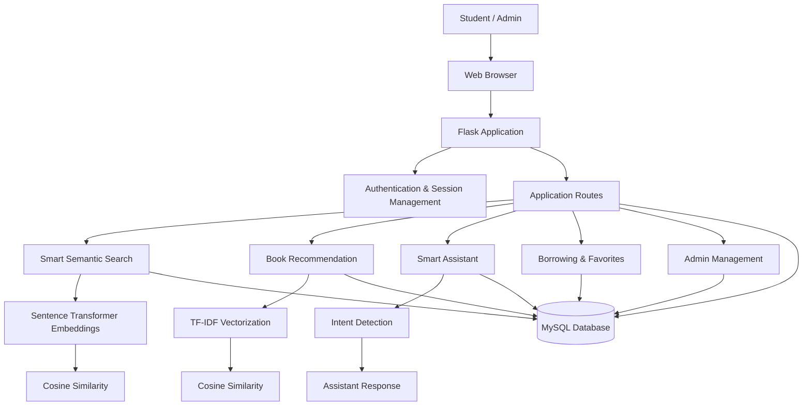

<!-- Ctrl + Shift + V عشان نشغل المخطط -->
# Smart AI Library - System Architecture

## System Architecture Diagram

## Architecture Description

The Smart AI Library system uses Flask as its backend framework. Students and administrators interact with the application through a web browser.

The Flask application handles authentication, application routes, and communication with the MySQL database.

The AI layer contains three main components:

1. Smart Semantic Search.
2. Book Recommendation System.
3. Smart Assistant.

The database stores information about students, books, borrowing records, favorites, and assistant chat history.
